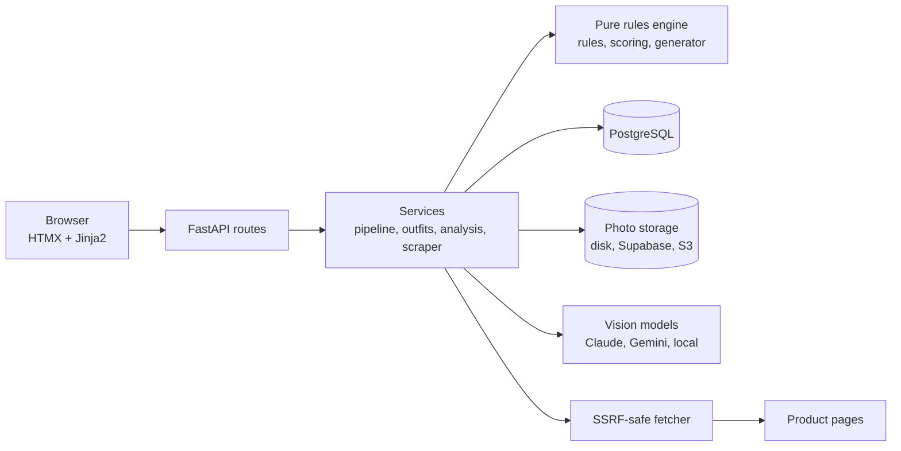

# Wardrobe

**Photograph your clothes. Get outfits you can explain. Find out whether a new purchase adds anything.**

Wardrobe is a web app where you upload photos of the clothes you own, confirm AI-suggested tags, and
get scored outfit suggestions with plain-English reasons. Paste a product link and it answers the
question that matters before you buy: **how many new outfits would this piece unlock in *my* closet?**

<!-- Add screenshots here, e.g. docs/images/closet.png, outfits.png, analyze.png -->


## Why it exists

Most outfit apps are a black-box stylist. This one is built on a different bet: **use AI where it
is good (reading a photo) and ordinary, inspectable code where trust matters (deciding what goes
together).** Every outfit and every "this piece unlocks 14 new outfits" verdict traces back to
stated rules you can read, tune and test.

## What it does

- **Closet from photos.** Upload several photos at once. Each is normalized (EXIF and GPS stripped),
  tagged by a vision model, and held for your review. Nothing counts until you confirm the tags.
- **Explainable outfits.** A top and bottom (or a dress), shoes, optional outerwear and
  accessories, scored from 0 to 1 with 2 to 4 reasons per outfit ("Navy and beige are both
  neutrals"). Regenerate without repeats, rate outfits, save them, plan the week.
- **"Dress me for today".** Pulls the forecast for your home city and adds temperature and rain
  constraints.
- **Purchase check.** Paste a product link or upload a photo. The app tags the piece like one of
  yours and reports the number of new outfits it would unlock, what it pairs with, what it never
  pairs with, whether it duplicates something you own, and what is missing when it unlocks nothing.
- **Closet statistics.** Total valid outfits and the most and least versatile pieces.
- **Style references (optional AI).** Add photos of outfits you admire; suggestions that resemble
  them rank a little higher. A per-request toggle lets you compare with and without the AI.
- **Accounts for a small group.** Private closets, invite-code registration, password reset.

## Engineering highlights

**A rules engine that stays out of the web layer.** `app/engine/` is pure Python with no database
or web imports (a test enforces it). *Hard rules* decide validity: structure, shared season, at
most two non-neutral colors, allowed pattern pairs, weather, and a declarative table of "makes no
sense" combinations. *Soft scoring* ranks valid outfits as a weighted geometric mean of color
harmony, patterns, materials, season fit and rain, so one clashing aspect pulls the whole score
down. Rules and weights are tables in [docs/outfit-engine.md](docs/outfit-engine.md), and a test
fails if the document and the code's defaults drift apart.

**Counting, not just generating.** Counting every valid outfit is what powers the purchase check.
Pairwise rules are precomputed as bitmasks, so partial outfits are pruned with integer operations
before they are ever scored. A varied 150-item closet (about 26,000 valid outfits) counts in about
0.1 s on a laptop; the benchmark is in the repo.

**AI with guard rails, in three places.**

- *Tagging:* the model must answer in a JSON schema generated from the app's own vocabulary; the
  answer is validated, retried once with the error appended, then rejected. A pixel-based color
  check cross-examines the model, per-field confidence highlights what to double-check, and a human
  confirms. Backends are pluggable (an offline fake, Claude or Gemini), and I ran the
  Gemini backend against real photos and checked the tags by eye.
- *Style references:* re-ranks only; it never changes which outfits are valid or the counts, is
  capped, explains itself on the card, and is off unless you tick it.
- *Personalization:* ratings nudge weights within hard caps and can be reset to the exact defaults.

**Safe link fetching.** Fetching user-supplied URLs is an SSRF risk, so all of it goes through one
module: http(s) only, every resolved address must be public (IPv4 and IPv6, including cloud
metadata ranges), the connection is pinned to the validated address, every redirect is re-checked,
responses are size- and type-limited, robots.txt is respected, and only the host is ever logged.

**Security and privacy by default.** Server-side sessions with hashed tokens, argon2id passwords,
session-bound CSRF, login and reset rate limits stored in Postgres, no account enumeration, a strict
Content-Security-Policy with no inline scripts, security headers and HSTS, per-user isolation on
every query, and photos served only through a login-checked route.

**Runs on a laptop or serverless.** Docker Compose for development; the same code also deploys to
Vercel with Supabase storage, no background workers (tagging runs per request), and the
heavyweight background-removal model made optional. See [docs/deployment.md](docs/deployment.md).

**Quality gates.** 782 tests (about 9,400 lines of tests against about 10,200 lines of application code):
golden outfits, hypothesis property tests of the engine, route and isolation tests, a test that
walks every route to prove it needs a login, and accessibility checks (WCAG AA contrast, labels,
focus). Ruff, strict mypy and the test suite are wired into a GitHub Actions workflow.

## Architecture



Routes stay thin, services hold the logic, and the engine knows nothing about either. Dependencies
(storage, tagger, mailer, weather, fetcher) are injected, so tests swap in fakes.

## Tech stack

| Layer | Choices |
|---|---|
| Backend | Python 3.12, FastAPI, SQLModel/SQLAlchemy, Alembic, Pydantic |
| Frontend | Server-rendered Jinja2, HTMX, a token-based stylesheet (no framework, no inline scripts) |
| Data | PostgreSQL 16 (JSONB for AI output and breakdowns) |
| AI | Claude and Gemini for tagging; Claude, Gemini, a local model (Ollama) or any OpenAI-compatible host for style references |
| Images | Pillow, pillow-heif (HEIC), optional rembg cutouts |
| Tooling | uv, Ruff, mypy (strict), pytest, hypothesis, Docker Compose, GitHub Actions |

## Run it

Prerequisites: Python 3.12, [uv](https://docs.astral.sh/uv/), Docker and make.

```bash
cp .env.example .env     # set a real POSTGRES_PASSWORD and keep the URLs in sync
make install
make up                  # Postgres 16
make migrate
make test
make user EMAIL=you@example.com   # create your account
make dev                 # http://localhost:8000
```

By default tagging uses an **offline fake tagger** so nothing leaves your machine. For real
recognition set `TAGGER_BACKEND=claude` or `gemini` and the matching API key in `.env`; photos are
then sent to that vendor (EXIF is stripped first). Demos without a browser: `make demo`,
`make demo-account`, `make demo-link`.

## Documentation

| | |
|---|---|
| [docs/outfit-engine.md](docs/outfit-engine.md) | Every rule, threshold and weight, plus the benchmark |
| [docs/link-analysis.md](docs/link-analysis.md) | How the purchase check works and what the scraper does and does not do |
| [docs/style-references.md](docs/style-references.md) | The optional AI re-ranking and its backends |
| [docs/deployment.md](docs/deployment.md) | Docker and Vercel on free tiers |
| [docs/accessibility.md](docs/accessibility.md) | What is tested automatically and the manual checklist |
| [docs/reference.md](docs/reference.md) | Phase-by-phase notes on every feature and setting |
| [DESIGN.md](DESIGN.md), [PRODUCT.md](PRODUCT.md) | Design system and product intent |

## Status and limits

A working personal project, not a commercial product. The core (closet, engine, purchase check,
accounts) is covered by tests and has been used end to end. The Vercel deployment, Supabase
storage and the style-reference backends were built against documentation and mocks; the Gemini
tagger was also run on real photos. Without a cutout model, photos are shown as uploaded. The
scraper reads only the page you paste and does not execute JavaScript by default.

## License

[MIT](LICENSE)
